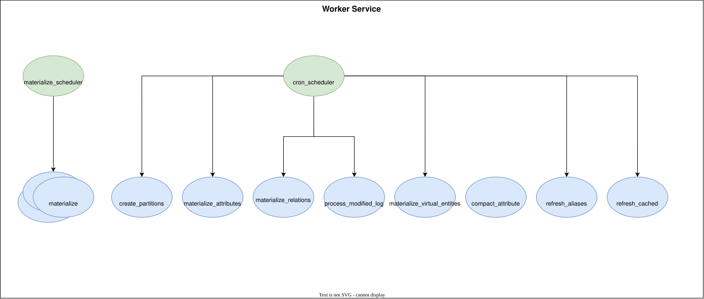

# Worker Service

The **Worker Service** is the new combined service that replaces the current mix of services so that it can run as a single containerized component next to the database it manages.

## Overview

Services replaced by the **Worker Service**:

1. 'materialize' service (Rust)
2. create-ahead-of-time-partitions service (system timer + Python script)
3. materialize-all-attributes (systemd timer + Minerva CLI command)
4. materialize-all-relations (systemd timer + Minerva CLI command)
5. process-modified-log (systemd timer + psql SQL command)
6. materialize-virtual-entities (systemd timer + Minerva CLI command)
7. compact-attribute (systemd timer + Minerva CLI command)
8. refresh-aliases (systemd timer + Python script)
9. refresh-cached (systemd timer + Python script)



The tasks will be executed in an async runtime. The 'materialize_scheduler' long-running task will only be responsible for spawning materialization tasks. The 'cron_scheduler' long-running task will be responsible for spawning all other worker tasks.

## Tech Stack

1. [Tokio](https://tokio.rs/) (async runtime)
2. [tokio-cron-scheduler](https://crates.io/crates/tokio-cron-scheduler) (scheduler)
3. [log](https://docs.rs/log/latest/log/) (generic logging framework)
4. [env_logger](https://crates.io/crates/env_logger) (simple logger and log configuration libary)
5. [tokio_postgres](https://docs.rs/tokio-postgres/latest/tokio_postgres/) (database client)
 
## Starting

The service will be started using a sub-command `service` of the Minerva CLI. The actual starting will use a sub-command `start` of that `service` command. So starting the service will look like this:

```
$ minerva service start
```

## Future Evolution

Not in scope for the first edition, but foreseen evolution of the Worker Service:

1. API for configuring the service (REST or other standard).
2. Complex arrangements of dependent tasks using dependency graphs to replace or reduce manual timing of scheduled tasks.
