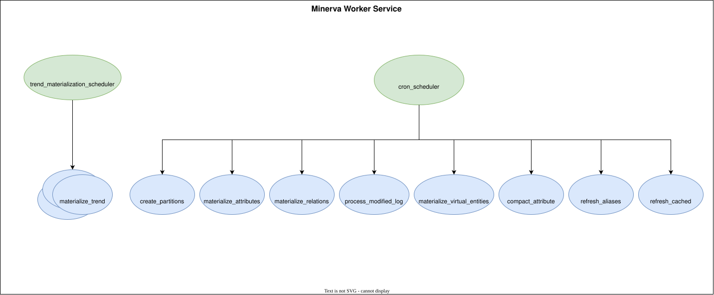

# Worker Service

The **Worker Service** is the new combined service that replaces the current mix of services so that it can run as a single containerized component next to the database it manages.

## Overview

Services replaced by the **Worker Service** tasks:

1. materialize (systemd service + Minerva CLI command)
2. create-ahead-of-time-partitions service (system timer + Minerva CLI command)
3. materialize-all-attributes (systemd timer + Minerva CLI command)
4. materialize-all-relations (systemd timer + Minerva CLI command)
5. process-modified-log (systemd timer + psql SQL command)
6. materialize-virtual-entities (systemd timer + Minerva CLI command)
7. compact-attribute (systemd timer + Minerva CLI command)
8. refresh-aliases (systemd timer + Python script)
9. refresh-cached (systemd timer + Python script)

## Tech Stack

1. [Tokio](https://tokio.rs/) (async runtime)
2. [tokio-cron-scheduler](https://crates.io/crates/tokio-cron-scheduler) (scheduler)
3. [log](https://docs.rs/log/latest/log/) (generic logging framework)
4. [env_logger](https://crates.io/crates/env_logger) (simple logger and log configuration libary)
5. [tokio_postgres](https://docs.rs/tokio-postgres/latest/tokio_postgres/) (database client)

## Starting

The service will be started using a sub-command `service` of the Minerva CLI. The actual starting will use a sub-command `start` of that `service` command. So starting the service will look like this:

```
$ minerva service start
```

## Tasks



The tasks will be executed in an async runtime. The 'trend_materialization_scheduler' long-running task will only be responsible for spawning materialization tasks. The 'cron_scheduler' long-running task will be responsible for spawning all other worker tasks.

### trend_materialization_scheduler

This long running task will check what materializations need to be run and create tasks for those materializations. The code can be reused/moved from the current `minerva trend-materialization service` Minerva CLI command.

### materialize_trend

Multiple of these tasks can be running for materializating trend data in parallel. The code can also be reused/moved along with the trend_materialization_scheduler.

### cron_scheduler

A long running cron-like scheduler that will spawn new asyng tasks for the various functionalities.

### create_partitions

A task scheduled by the cron_scheduler and the logic is already implemented for the `minerva trend-store partition create` command.

### materialize_attributes

A task scheduled by the cron_scheduler. The logic is already implemented for the `minerva attribute-store materialize` command.

### materialize_relations

A task scheduled by the cron_scheduler. The logic is already implemented for the `minerva relation materialize` command.

### process_modified_log

A task scheduled by the cron_scheduler. This is a very simple task for executing exactly one SQL query:

```
SELECT * FROM trend_directory.process_modified_log()
```

### materialize_virtual_entities

A task scheduled by the cron_scheduler. The logic is already implemented for the `minerva virtual-entity materialize` command.

### compact_attribute

A task scheduled by the cron_scheduler. The logic is already implemented for the `minerva attribute-store compact --all-modified` command.

### refresh_aliases

A task scheduled by the cron_scheduler. The logic can by taken from the current Python script and converted into a Rust module.

### refresh_cached

A task scheduled by the cron_scheduler. The logic can be taken from the current Python script and converted into a Rust module.

## Future Evolution

Not in scope for the first edition, but foreseen evolution of the Worker Service:

1. API for configuring the service (REST or other standard).
2. Complex arrangements of dependent tasks using dependency graphs to replace or reduce manual timing of scheduled tasks.
